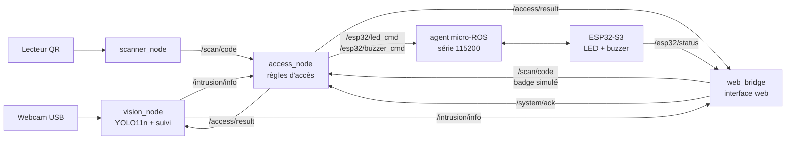

# SentinelAI

Prototype de **surveillance intelligente de zones** et de **contrôle d'accès par vision artificielle**. Tout le traitement vidéo est local.

## Fonctionnalités

- Détection de personnes en temps réel (YOLO11n) et suivi (ByteTrack)
- Zones autorisées / interdites avec temporisation de confirmation
- Contrôle d'accès par badge QR (identifiant opaque, sans reconnaissance faciale)
- Journal des événements SQLite avec rétention de 30 jours
- Alertes matérielles via ESP32-S3 : LED verte (accès valide), LED rouge + buzzer (intrus)
- Interface web responsive (onglets, thème clair / sombre, mobile)
- Architecture ROS 2 Jazzy + micro-ROS

## Architecture



## Matériel

| Composant | Détail |
|---|---|
| PC | Ubuntu 24.04, GPU NVIDIA (RTX 3060 testée) |
| Microcontrôleur | ESP32-S3 (port série `/dev/ttyACM0`) |
| Caméra | Webcam USB |
| Lecteur | Lecteur de code QR / code-barres |
| LED verte | GPIO 6 |
| LED rouge | GPIO 15 |
| Buzzer | GPIO 18 |

## Installation

Prérequis : Ubuntu 24.04, ROS 2 Jazzy, Python 3.12, un workspace micro-ROS avec l'agent compilé (par défaut `~/microros_ws`, modifiable avec la variable `MICROROS_WS`).

```bash
git clone https://github.com/mahdibh314/SentinelAI.git
cd SentinelAI

# Configuration
cp .env.example .env
# puis modifier WIFI_PASSWORD dans .env

# Firmware ESP32 : mot de passe du point d'accès Wi-Fi
cp esp32_fw/include/secrets.h.example esp32_fw/include/secrets.h
# puis modifier WIFI_AP_PASS dans secrets.h
```

## Utilisation

```bash
./deploy install   # installation des dépendances et build (une seule fois)
./deploy check     # diagnostic matériel et logiciel
./deploy flash     # compile et téléverse le firmware sur l'ESP32-S3
./deploy deploy    # lance l'agent micro-ROS et tous les nœuds (commande par défaut)
./deploy stop      # arrête tous les processus
```

L'interface web est disponible sur `http://localhost:8000`.

## Confidentialité

- Aucune reconnaissance faciale
- Traitement vidéo 100 % local
- Aucune vidéo conservée, journal d'événements limité à 30 jours
- Un identifiant de suivi n'est jamais une identité : en cas d'ambiguïté, l'identité reste non confirmée

## Structure du dépôt

| Dossier / fichier | Rôle |
|---|---|
| `ros2_ws/src/sentinelai/` | Nœuds ROS 2 (`vision_node`, `scanner_node`, `access_node`, `web_bridge`) |
| `esp32_fw/` | Firmware ESP32-S3 (PlatformIO + micro-ROS) |
| `web/` | Interface web |
| `config/` | Paramètres et filtres (YAML) |
| `badges/` | Badges QR de démonstration |
| `step1_...` à `step7_...` | Prototypes de la phase de développement (caméra, détection, suivi, zones, règles, QR, journal) |
| `deploy` | Script de déploiement et de gestion |

## Auteur

Mahdi BOULOUAH, étudiant en génie électrique / automatique à l'USTHB.
